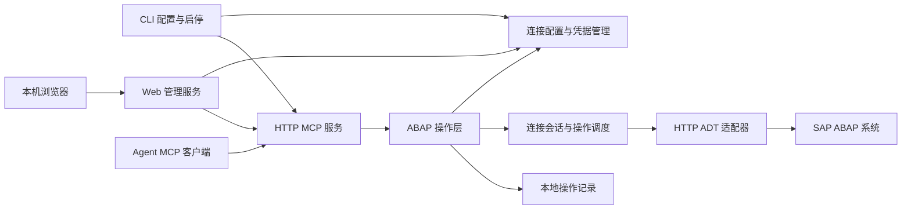

# SapLink 架构

本文说明 SapLink 当前源码的模块、接口和操作流程，核对时 package.json 版本为 1.0.1，不表示该版本已公开发布。产品介绍见 [README](../README.md)，安装与使用步骤见 [部署与运维手册](operations.md)。CLI 入口和包名为 saplink；配置目录、凭据服务名、环境变量和安装登记标识见[命名与本地数据](local-data.md)。

客户端操作见 [MCP 客户端手册](mcp-client-guide.md)，部署与排障见 [运维手册](operations.md)，外部分发链路见 [发布与 Actions](releases-and-actions.md)。本文描述实现，不表示所有功能已在每个 SAP 版本验证。

## 1. 目标与范围

版本检查由 `src/updates.ts` 提供：默认优先使用 COS 清单，不可用时自动回退 GitHub 官方正式 Release。CLI 普通检查缓存 24 小时；长期运行的 CLI/UI 启动后异步重新查询更新源，此后每小时重新查询，不复用旧缓存，不创建系统任务。新版本经受保护的状态接口提供给 Web，侧栏“软件更新”显示红色 New，进入页面直接显示版本及自动更新操作；无新版本时保留手动检查。后台检测不弹窗、不写历史通知文件，也不会自行安装。`SAPLINK_AUTO_UPDATE_CHECK=0` 可关闭自动检查。命令与缓存规则见 [版本检查](operations.md#检查新版本)。

发布端使用两个独立 COS 清单：安装包 `saplink/latest.json` 仅含 schema_version、version、published_at、downloads，兼容已发布的严格校验客户端；技能 `saplink/skill-latest.json` 单独存放版本、源码提交、ZIP 地址、大小和哈希。官网代理这两个小型清单，浏览器直接从 COS 下载二进制。打包和 Actions 的来源选择见 [发布手册](releases-and-actions.md)。

用户确认后的更新安装由 `src/self-update.ts` 与独立原生助手 `packaging/windows/update-runner.ps1` 完成：重新核对版本和架构、下载并校验安装包，再正常关闭当前应用、等待在途操作收尾，在原目录安装并尝试恢复原运行方式。仅支持包含助手的 Windows 安装版，不提供强杀、自动回滚或未经确认的静默升级。详见 [开发验证](development.md#自动更新实现与验证) 和 [运维流程](operations.md#用户确认的自动安装)。

提供不依赖 VS Code 的本地 Web 管理界面与 CLI，通过 HTTP/HTTPS ADT 访问 SAP ABAP 系统，并向 agent 提供 Streamable HTTP MCP tools。后端 HTTPS 沿用默认 TLS 校验，不自动降级；本机管理与 MCP 监听仍使用 loopback HTTP。

当前功能包括：

- Windows x64 / ARM64 安装包，内置运行环境，无需另装 Node.js 或 npm；安装步骤见 [Windows 安装指南](windows-installer.md)。
- 手动配置多个 SAP 连接，测试登录并探测 ADT 能力。
- 本地 Web 管理界面、双击启动脚本、连接与令牌管理、MCP 服务启停。
- HTTP MCP 服务及本地访问令牌认证。
- 搜索对象、浏览包、读取源码。
- 只读查询 DDIC 字段、数据元素、域固定值、引用与定义位置、类及接口成员和类型继承关系，见 [仓库语义查询](repository-query.md)。
- 通过独立 DDIC 和 freestyle Data Preview 接口查询表数据及执行只读 ABAP SQL。
- 创建 REPORT、Include、模块池和子程序池；修改与激活 Program（PROG/P）和 Include（PROG/I）的主源码，提供语法检查。
- 创建函数组与空函数模块，浏览成员，修改及检查函数模块和组内 Include；通过组快照校验整体激活。
- 对象锁、版本冲突、传输请求和部分失败处理。

当前不提供 stdio MCP、SNC/SSO、调试、任意 ABAP 执行、删除对象或释放传输请求。RFC/JCo 支持应用服务器直连或不带路由密码的 SAProuter，以及从本地 SAP Logon 配置导入连接参数；配置及能力边界见 [ADT over RFC](rfc-transport.md)。

## 2. 总体架构



主体采用单进程模块化结构，不拆分微服务。可选 RFC 模式由主体管理各通道的 Java/JCo 子进程，通过私有管道通信。CLI 启动服务后，各连接按需建立独立 SAP 会话。MCP 会话不等于 SAP 会话，不向 agent 暴露 SAP cookie、CSRF token 或锁句柄。

技术栈：TypeScript、Node.js、官方 MCP TypeScript SDK、Express、Zod、`abap-adt-api` 和 Axios。Windows 凭据使用 `@napi-rs/keyring`，依赖版本记录在 package.json 与 package-lock.json。业务层通过 Backend 接口调用 ADT 适配器。

| 模块 | 职责 |
| --- | --- |
| CLI | 交互输入、隐藏密码、配置管理、连通性测试、服务生命周期 |
| Web 管理 | 静态 HTML/CSS/JS、独立管理认证、配置 API、MCP 启停 |
| 配置与凭据 | 持久化非敏感配置，按连接 ID 访问 Windows 凭据管理器 |
| MCP 层 | 协议协商、认证、参数验证、tools 注册、统一结果转换 |
| ABAP 操作层 | 对象语义、写入策略、版本校验、错误分类、操作记录 |
| 会话与调度 | SAP 登录状态、会话过期、并发控制、锁生命周期 |
| ADT 适配器 | discovery、媒体类型与能力适配、HTTP 请求和响应解析 |

### 实现文件与维护边界

工具定义和写操作分类已从 HTTP 注册与业务执行代码中抽离。当前职责如下：

| 文件 | 职责 |
| --- | --- |
| `src/tool-definitions.ts` | 导出 toolSchemas、ToolName 和 toolDescription，集中维护参数校验及客户端描述 |
| `src/quality-tools.ts` | ATC/Unit schema、单对象执行、结果汇总和版本读取；分析会话禁用隐式执行重放 |
| `src/source-versions.ts` | 历史 Atom 解析；HTTP 同源校验，RFC 当前对象范围内的 ADT 路径校验 |
| `src/source-diff.ts` | 有界行差异计算和输出截断 |
| `src/reference-query.ts` | where-used 节点与片段两阶段查询、XML 标识转义、位置去重和展开预算及部分结果 |
| `src/repository-query.ts` | 仓库语义查询的 schema、只读 ADT 适配、源码定位、域值字符串解析及嵌套结果数量限制 |
| `src/tool-policy.ts` | 导出 writeTools，统一定义需要写保护的工具集合 |
| `src/server.ts` | 使用上述定义注册 MCP tools、生成 annotations，并提供 HTTP 认证和传输 |
| `src/operations.ts` | 根据同一 writeTools 执行写入开关、会话预检、请求去重及业务流程 |
| `src/client-guidance.ts` | MCP 初始化时提供的客户端操作指引 |
| `src/config.ts` | 连接 schema、URL 规范化、配置及令牌校验、Windows 凭据访问 |
| `src/errors.ts` | 后端错误分类与脱敏，由 safeError 形成对外错误 |

新增写工具时必须同步工具 schema、描述、writeTools 和操作实现，避免 annotations 声明为只读却执行写入，或遗漏写入保护。当前 writeTools 包含 create_program、create_function_group、create_function_module、create_transport_request、update_source、activate_objects，以及 run_atc、run_unit_tests 共八项。后两项不保存源码，但会创建检查记录或执行后端测试代码，因此同样需要开启写入、明确执行确认和请求防重复。

工具模块抽离不改变 HTTP 地址或认证方式。新增仓库语义查询工具通过同一注册流程接入；客户端通过运行时 tools/list 获取当前接口，不依赖源码文件布局或固定工具数量。

## 3. 连接模型

| 字段 | 含义 |
| --- | --- |
| `connection_id` | 稳定内部 UUID，编辑连接不改变它；当前无重命名命令 |
| `name` | 用户定义的唯一名称，仅允许英文字母、数字、下划线和连字符 |
| `base_url` | SAP HTTP 地址，例如 http://sap-host:8000 |
| `client` | 三位数字字符串，例如 001，保留前导零 |
| `username` | SAP 用户名 |
| `language` | ADT 登录语言参数，例如 EN；按后端支持验证 |
| `write_enabled` | 默认 false，由本地配置显式启用 |

SAP 连接支持 HTTP/HTTPS ADT。`base_url` 不含用户名、密码、查询参数和 fragment；CLI 可接受末尾 `/sap/bc/adt` 并规范化，其他自定义反向代理路径暂不支持。端口由用户填写，不根据系统号推算。

配置存放在 `%APPDATA%\saplink\config.json`，含 `schema_version=1`，可由 `SAPLINK_CONFIG_DIR` 覆盖。连接没有 credential_ref 字段，直接按 connection_id 访问 Windows 凭据管理器。配置更新采用临时文件加 rename；删除连接时清理凭据。CLI 使用 runtime.lock 禁止服务运行期间添加、编辑或删除连接，config.lock 串行化配置变更；服务运行时可管理令牌。

UI 进程同样持有 runtime.lock，避免另一个 CLI 服务同时操作该配置目录。Web 管理操作串行化并使用 config.lock；MCP 已停止时可在 UI 内变更连接。编辑时变更 URL、Client 或用户名必须重新输入密码，保存失败时尽力恢复原凭据。

HTTP Basic 凭据和代码流量没有 TLS 加密，应在可信网络内使用。HTTP 客户端不向其他 origin 转发认证信息。

## 4. CLI 设计

以下命令已实现；实际执行方式和环境要求见 [部署与运维手册](operations.md) 和 [AI 终端管理](ai-management.md)。

表中的 `<连接名称>`、`<令牌ID>` 为占位符，执行前替换为实际值，不保留尖括号。连接名称由用户定义，不是命令的固定部分。项目内可使用 `npm start -- connection add <连接名称>` 等方式执行。

| 命令 | 行为 |
| --- | --- |
| `saplink connection add <连接名称>` | 交互填写连接，隐藏输入密码 |
| `saplink connection list` | 列出 ID、名称、URL、Client、用户名及写入开关，不登录系统 |
| `saplink connection edit <连接名称>` | 修改配置或更新凭据 |
| `saplink connection remove <连接名称>` | 删除配置和关联凭据 |
| `saplink connection test <连接名称>` | 验证网络、登录、discovery 和后端能力 |
| `saplink token create` | 生成高熵 MCP 令牌，明文仅输出一次 |
| `saplink token revoke <令牌ID>` | 撤销指定令牌 |
| `saplink serve --port 8765` | 前台启动服务，固定监听 127.0.0.1 |
| `saplink ui --port 8766` | 启动管理界面并打开默认浏览器，MCP 由页面控制启停 |

连接测试按唯一名称选取配置，登录并输出 discovery 和探测时间，结束后退出会话。它是只读操作，不通过创建程序测试权限。错误分类以当前 errors.ts 为准，不把所有 HTTP 403 都解释为权限不足。成功读取不代表具有写入权限。

密码不接受命令行明文参数。凭据存储失败必须报告，不回退到配置文件明文存储。首次版本要求 Windows 凭据管理器可用。

## 5. MCP HTTP 服务

Web 管理端口独立于 MCP，默认监听 127.0.0.1:8766。启动生成随机管理密钥，经浏览器 URL fragment 传入后移至标签页 sessionStorage；API 用 X-Admin-Token 校验，不接受 MCP Bearer 作为管理认证。API 要求正确 Host、变更请求要求同源 Origin，没有跨域许可；最多 8 个在途请求，JSON 请求体上限 16 KiB。静态页面不含管理密钥，CSP 禁止外部脚本和嵌入，所有响应禁用缓存。

- 端点：`http://127.0.0.1:8765/mcp`，端口可配置。
- 传输：Streamable HTTP，使用官方 SDK，支持初始化及协议版本协商。
- 认证：`Authorization: Bearer <token>`；服务端存储令牌校验值，不保存令牌明文。
- 网络：固定绑定 127.0.0.1，Host 要求 127.0.0.1:端口；localhost 被拒绝，所有带 Origin 的请求被拒绝。
- 会话：MCP 使用无状态传输，每个 POST 建立 SDK server/transport，响应结束后关闭；每个请求仍需认证。SAP 会话按连接保留。
- HTTP 行为：POST /mcp 由 SDK 处理，GET、DELETE 及其他方法返回 405，没有 GET 事件流。
- 限制：JSON 请求体 2 MiB；source 字符串最多 1,048,576 个 JavaScript 字符；列表 limit 默认 100、最大 500；激活列表最多 20；HTTP 在途请求（包含认证阶段）最多 16，操作队列最多 100，内存写请求索引最多 512 条。认证失败、连接断开和响应结束都释放请求名额。
- 超时：SAP 单请求 15 秒，请求/响应大小分别限制为 2/4 MiB；本地 HTTP requestTimeout 30 秒、headersTimeout 10 秒。requestTimeout 不等于完整 SAP 操作的执行期限。

令牌授予访问此服务中已配置连接的能力，当前不提供逐令牌的连接授权。连接不限定包，实际读写权限由 SAP 用户权限决定，连接写入开关仍由服务端执行，SAP 要求记录变更时需提供传输任务。连接配置拒绝未知字段，不兼容旧版包限制配置。agent 不能用 tools 修改连接、凭据、令牌或写入策略。

服务在前台运行，收到退出信号后停止接收新请求，等待在途操作并清理锁。日志与配置输出不得泄露密码、认证头、cookie 或 CSRF token。

## 6. MCP Tools 契约

除 `list_connections` 外，所有操作必须提供 `connection_id`，不使用隐式当前系统。对象 URI 从查询结果获得；只允许当前连接下合法 ADT 相对路径，禁止外部 URL、目录穿越或任意 HTTP 请求。

| Tool | 主要参数 | 主要结果 |
| --- | --- | --- |
| `list_connections` | 无 | ID、名称、write_enabled，不探测实时登录状态 |
| `get_capabilities` | `connection_id` | discovery 支持的能力及探测时间 |
| `search_enhancements` | 连接、query、可选 type、limit | 增强对象、coverage、truncated 和仓库版本探测证据 |
| `search_objects` | 连接、`query`、可选类型、`limit` | 名称、类型、包、对象 URI、是否截断 |
| `query_table` | 连接、表名、可选字段和 AND 筛选、`limit` | 列元数据、字符串行、返回行数、是否截断 |
| `query_sql` | 连接、单条只读 SELECT、`limit` | 列元数据、字符串行、返回行数、是否截断 |
| `list_package_objects` | 连接、`package_name`、`limit` | 后端节点字段、truncated、pagination_supported=false |
| `read_source` | 连接、`object_uri`、可选 `source_uri`、`version` | 源码、源码 URI、实际版本、revision、哈希 |
| `create_program` | 连接、`name`、`description`、`package_name`、`program_kind`（默认 report）、可选 `transport_task`、`request_id` | 对象 URI、program_kind、创建状态 |
| `create_function_group` | 连接、name、description、package_name、可选 transport_task、request_id | 组 URI、FUGR/F、创建状态 |
| `create_function_module` | 连接、name、description、function_group_uri、可选 transport_task、request_id | 成员 URI、父组 URI、FUGR/FF、创建状态 |
| `list_function_group_members` | 连接、function_group_uri、limit | FUGR/FF 和 FUGR/I 成员及截断标记 |
| `get_function_group` | 连接、function_group_uri | 成员版本、源码 revision、组快照 revision |
| `update_source` | 连接、`object_uri` 或 `source_uri`（至少一个）、`source`、`expected_revision`、可选 `transport_task`、`request_id` | 保存状态、新 revision、inactive 状态 |
| `syntax_check` | 连接、`object_uri`、`version` | 是否通过、结构化诊断 |
| `activate_objects` | 连接、对象 URI 与预期 revision 列表、`request_id` | 各对象结果及部分失败信息 |
| `list_transport_requests` | 连接 | 当前用户的后端传输请求数据，无状态过滤参数 |
| `create_transport_request` | 连接、object_uri、package_name、description、request_id | 创建返回编号、读回确认的父请求及当前用户任务；不释放 |

`version` 使用 `active` 或 `inactive`；不存在指定版本时明确返回错误，不静默切换版本。`revision` 是服务封装的不透明值，包含版本上下文；源码 SHA-256 用于补充校验，不作为历史恢复承诺。

当前没有分页和 cursor 参数。包列表先剔除没有 OBJECT_URI 的节点，再限量和判断截断。搜索对完整子类型精确过滤，对类型族按族过滤；子类型搜索最多扫描后端 501 条类型族结果。达到扫描上限时即使返回对象不足 limit，也可能 truncated=true，需要缩小搜索条件。

进入操作执行阶段的结果包含 operation_id、status、completed_steps；成功包含 data，失败包含 error。写入结果还包含 outcome：confirmed、partial 或 unknown，可带 warnings。队列、重复请求冲突等执行前错误由 MCP 包装为 status/error，不保证包含 operation_id。结果通过 structuredContent 和文本 JSON 返回，工具失败设置 isError；schema 参数校验由 SDK 处理。

update_source 在解析源码对象 URI 后提供 source_save：saved 为 false（未发出保存）、unknown（已发出但未确认接受）或 true（SAP 接受保存）；verification 为 not_run、pending、passed、failed 或 unavailable。读回成功才提供 inactive_revision，不推测未读到的版本。校验失败仍保留 saved=true，顶层 error/outcome=partial，并提供先读取草稿的 next_action；读回失败为 unavailable。该状态不包含源码或锁句柄，重复请求缓存保留它，但缓存结果不是实时状态。源码比较策略不变，不自动覆盖草稿或激活。

list_connections 显式返回 base_url、client、language、username 和写入策略以辨识系统，不含凭据或令牌。create_program/create_function_module 返回下一步 read_source 调用（初始请求 inactive），通过 SAP 元数据发现源码地址；版本不存在时应显式读取 active。create_function_group 指引读取组快照，不提供虚构的 source/main。创建后的指引不额外访问 SAP，不影响创建成功状态。

update_source 兼容 source_uri，并接受 object_uri；至少提供一个，同时提供时校验两者一致。主源码 URI 来自锁内读取的元数据，未发现前 source_save 不填写推测的 source_uri。expected_revision 仍必填；VERSION_CONFLICT 返回已观察到的版本 revision 和读取指引，禁止客户端据此盲目覆盖或自动重试，缓存中的错误信息不是实时快照。

函数模块 HTTP 400 的 ExceptionResourceScanDuringSaveFailure 增加上下文 hints：EXCEPTIONS 只列名称，不使用调用时的返回码映射；TABLES 使用 ADT 类型声明；定义区注释可能被重建，实现区不得使用保留注释前缀。提示仅用于排查，不替换 SAP 原始错误标识、不确定性状态，也不自动改写输入。

函数定义区等价验证限于函数模块 URI。受限词法与声明解析器识别 FUNCTION 名称、按原顺序排列的参数方向、VALUE/REFERENCE、TYPE/LIKE、REF TO、简单 STANDARD TABLE [OF type]、OPTIONAL、简单 DEFAULT 字面量或标识符及经典 EXCEPTIONS。标识符按大写 token 比较，字面量按原文比较，注释单独记录；句点只在非字面量和非注释中作为定义区结束。未知语法退回原验证。实现区维持原验证，不扩大容忍范围。保存返回 normalization_applied 和差异分类；定义区注释变化必须警告。组快照的源码比较哈希使用相同规则，revision 仍使用原始回读源码，不放宽并发版本检查。规范化仅用于验证，不修改提交或缓存的源码。该实现不依赖完整 ABAP 编译器，不承诺解析所有后端语法。

语法检查返回 passed、diagnostics 和 position_format；diagnostics 保留后端 uri、line、offset、severity、text，没有统一转换为 1-based 行列。检查失败通常返回 passed=false 的业务结果，不单独生成 SYNTAX_CHECK_FAILED 错误。

## 7. SAP 会话与能力

新写请求在业务操作前替换缓存且锁状态正常的会话，建立新会话并验证 ADT discovery。预检失败时不加锁、不发送业务写请求；预检成功也不能保证后续网络始终可用，因此进入写入阶段后不自动重放。锁状态异常时阻止写入，不能靠重建会话绕过。结果通过 write_dispatched 明确是否尝试提交业务变更。

连接首次使用时创建 ADT 客户端，HTTP 请求按需登录。get_capabilities 获取 discovery，其他 tools 不强制先调用该 tool。客户端实例在进程内按连接缓存，cookie、CSRF token 和认证状态按连接隔离。

ADT 库处理媒体类型和各操作接口；读取通过对象元数据发现主源码，写入核对 programs/programs 路径对应 PROG/P、programs/includes 路径对应 PROG/I，不限制已有 Program 的 programType 为 executableProgram。创建时使用 XMLBuilder 构建请求，显式传递选定类型并读回验证。discovery 用于能力展示，尚未实现按 discovery 自动禁用 tools。锁操作使用 stateful SAP 会话；同一连接的所有操作串行执行，不同连接使用独立队列。

CSRF 获取和更新由适配器处理。只有明确尚未执行的请求才可安全重试；网络超时不能直接解释为写入失败。若会话失效发生在持锁期间，先核实操作结果和锁状态，不自动换会话继续写入。

## 8. 对象创建、保存与激活

### 8.1 创建程序

创建工具根据 program_kind 生成对象壳：report 对应 PROG/P 的 executableProgram，module_pool 对应 modulePool，subroutine_pool 对应 subroutinePool，include 对应 PROG/I。默认 report，兼容未指定类型的调用。创建、写入源码和激活是独立操作。

先通过 ADT 库进行命名和包验证，再发送结构化 XML 到 programs/programs 或 programs/includes 集合；Program 的 program:programType 明确指定。创建后按对象路径读取元数据验证 adtcore:type 和 Program 子类型。SAP 拒绝或类型不符时返回错误，不自动回滚已创建对象。模块池屏幕等附属资源不由此工具创建。

验证连接写入策略、命名、目标包、对象不存在及传输任务，再通过 ADT 创建对象，返回真实 URI。远程创建存在竞态，以 SAP 返回为准。`$TMP` 可省略任务；其他包省略任务时先执行 ADT transportchecks 检查，通过独立无状态会话传入对象 URI 和包，CTS OPERATION=I 表示对象加入变更记录。仅成功响应 RESULT=S 且 RECORDING、KORRFLAG 明确为空时确认无需任务；RECORDING=X 时要求任务。其他响应及查询失败均阻止写入，返回 TRANSPORT_CHECK_UNAVAILABLE。显式任务直接交由 SAP 校验，不缓存查询、不自动选任务、不试写探测。源码及对象创建流程不自动创建传输请求；创建请求必须显式调用 create_transport_request，不提供释放请求功能。

create_transport_request 是写操作，复用连接 write_enabled、串行队列、新会话预检、JSONL 日志和 request_id 索引。针对已存在或待创建的 Program、Include、函数组或函数模块及目标包，先执行只读 CTS 检查；明确无需记录或无法确认时，不发出创建。通过 ADT /cts/transports 创建后验证返回编号格式，再通过当前用户传输列表，在可修改 Workbench 请求中查找该编号或其所属任务，以区分请求与任务。仅返回当前用户最多 20 个任务及截断标志，不自动选定任务，不创建源码对象，不释放请求。

创建后读回失败返回 TRANSPORT_VERIFY_FAILED/outcome=partial，保留 created=true、transport_number 和后续查询指引；创建响应不含有效编号返回 TRANSPORT_RESPONSE_INVALID/outcome=unknown，不能断言未创建。网络失败不自动重放；本地 request_id 索引仅覆盖当前进程，不保证跨重启恰好创建一次。未知结果必须先查询，未提供自动回滚或删除请求功能。

创建成功后 agent 使用返回 URI 读取初始源码，再调用修改与激活。后续失败不自动删除已创建对象。

### 8.2 保存源码

```text
验证输入、连接写入开关、对象所属包和传输任务
→ 获取 SAP 对象锁
→ 在锁内重读目标源码并核对 expected_revision
→ 通过 ADT 保存 inactive 源码
→ 读回确认并生成新 revision
→ 释放锁
→ 返回已完成步骤与最终状态
```

当前不使用 ETag 或 If-Match；revision 由连接 ID、源码 URI、active/inactive 版本及源码 SHA-256 生成，在锁内重读并校验。写入支持 Program、Include、函数模块及函数组 Include 的 source/main，函数组容器不能作为源码修改。预期版本不一致，或从 active revision 覆盖不同 inactive 草稿时，返回 VERSION_CONFLICT。

保存后的读回比较统一换行格式并忽略纯空行，但保留多行字面量中的空行；非空行的顺序、缩进、注释和字符串仍参与比较。受支持的函数定义另按参数 token 等价比较，实现区不折叠非空行。revision 和 hash 始终基于后端实际文本生成。

保存与语法检查分开：保存成功不等于语法通过，也不等于激活。锁释放在 finally 路径执行；解锁失败不能覆盖已经成功保存的事实。

### 8.3 语法检查与激活

语法检查针对明确版本调用后端支持的检查能力，返回结构化诊断。激活是独立写操作：在编辑锁内核对 inactive revision，释放编辑锁后再次核对，再调用 SAP 激活接口，由激活接口获取所需锁。解锁失败或版本变化时不发出激活请求；激活成功后读回 active 源码进行验证。解锁到激活之间存在并发窗口，不承诺原子版本条件激活。

多对象激活先统一校验全部版本，再以一个集合提交给 SAP；不按输入顺序逐个激活。返回逐对象 results，组内嵌 member_results；即使提交失败或结果未知，也尽可能读回全部成员，区分已核实、草稿仍在、内容不一致和无法核实。读回沿用保存比较策略。组内 inactive 成员、组容器与其他已选对象使用同一联合请求；不自动纳入额外依赖或回滚，不承诺跨对象原子性。

## 9. 错误与恢复

函数对象使用 FUGR/F（组）、FUGR/FF（函数模块）及 FUGR/I（组内 Include）。函数模块源码编辑的 lock/unlock 指向模块自身，组内 Include 当前指向父组，保存指向成员源码 URI。源码版本读取使用独立的无状态 ADT 会话，不共享持锁写入会话的 Cookie，避免版本探测改变编辑上下文；版本冲突检查仍在 SAP 对象锁持有期间执行。HTTP 错误响应交给 ADT SDK 更新 Cookie 并分类，重定向仍拒绝。get_capabilities 的 source_read_policy 为 separate_stateless_session。创建函数模块前核对父组类型、所属包和传输任务，并在组锁下创建；请求 XML 通过 XMLBuilder 转义构建。创建后核对对象类型，失败不自动删除对象。

组整体激活的 expected_revision 来自 get_function_group，不是虚构的 source/main。快照包含组名、变更时间和排序后的成员 URI、版本、源码 revision 及按保存比较策略生成的内容哈希；组快照读取优先 inactive，指定版本不存在时使用 active，这不同于 read_source 的显式版本要求。组锁内校验、解锁后二次校验、整体激活并读回成员。最多 500 个成员；组快照无分页、不覆盖接口参数的完整 XML 定义，也不承诺原子激活。当前没有结构化接口维护工具，但支持源码式 FUNCTION 定义的后端可通过源码修改参数；可选整型 IMPORTING 声明和 TABLES 的 `T_RETURN TYPE BAPIRET2 OPTIONAL` 声明已验证，其他接口特性应分别验证。ADT 定义区不使用旧式 `STRUCTURE BAPIRET2`，也不是 Local Interface 注释；最后一个声明以句点结束。SAP 会从持久化接口重新生成定义区，可能规范化格式；受支持定义语法按 token 等价校验，其余按保存比较策略核实，失败时应读取 inactive 状态。

| 错误码 | 含义与恢复方式 |
| --- | --- |
| `AUTH_FAILED` | 更新本地凭据，再测试连接 |
| `HTTP_FORBIDDEN` / `CSRF_FAILED` | HTTP 403 按后端错误消息分类，不能单凭 403 判断开发权限 |
| `ADT_UNAVAILABLE` | 连接地址或 ADT 服务不可用 |
| `CAPABILITY_UNSUPPORTED` | 当前后端不支持该操作 |
| `DATA_PREVIEW_FAILED` | 数据预览 HTTP 请求失败；结合请求路径、状态和恢复次数诊断，不等同于不支持 |
| `WRITE_DISABLED` | 本地连接未启用写入 |
| `OBJECT_NOT_FOUND` | HTTP 404；可能是对象不存在或接口路径不可用 |
| `CREATE_VALIDATION_FAILED` | 创建前验证未通过；其他后端创建错误可能归入 ADT_ERROR |
| `OBJECT_LOCKED` | HTTP 409/423 或识别为编辑锁的 403，不强制解锁 |
| `VERSION_UNAVAILABLE` / `PACKAGE_UNKNOWN` | 无法取得指定版本或核实所属包 |
| `VERSION_CONFLICT` | 重读目标版本，再生成修改 |
| `TRANSPORT_REQUIRED` | SAP 明确要求本次创建或修改记录变更时需要任务；检查失败返回 TRANSPORT_CHECK_UNAVAILABLE；无效任务由 SAP 拒绝 |
| `ACTIVATION_FAILED` | 返回逐对象结果和实际完成阶段 |
| `LOCK_CLEANUP_FAILED` | 明确主操作是否成功，并记录待清理锁 |
| `SESSION_NEEDS_REVIEW` | 先前解锁失败或锁状态未知，阻止该连接后续写入 |
| `VERIFY_FAILED` | 保存或激活后的读回源码与预期不一致 |
| `LOG_UNAVAILABLE` | 写入前不能记录日志，不发出 SAP 写请求 |
| `REQUEST_ID_CONFLICT` / `REQUEST_LIMIT` | 重复 ID 参数冲突，或内存请求索引已满 |
| `BUSY` / `SERVER_STOPPING` | 操作队列已满或服务正在退出 |
| `ADT_ERROR` | 未进一步分类的后端错误，原始响应不返回给 agent |
| `OUTCOME_UNKNOWN` | 写请求超时或连接中断，读回核实后再决定重试 |

后端错误优先从 response.status、status 或 ADT XML 异常的 err 字段获取 HTTP 状态。仅对 ADT 库识别的 SAP 异常提取消息和白名单属性；error.details 可包含 http_status、sap_message、sap_error_type、sap_message_id、sap_message_number。消息最大 1024 字符，脱敏密码、Authorization、cookie、CSRF 和锁句柄；认证失败不返回 SAP 消息文本，不输出请求配置、响应正文或异常堆栈。get_capabilities 同时返回 source_lock_policy，便于核对运行中服务的锁策略。

写操作带客户端 `request_id`。内存索引保存请求摘要和精简结果，结果去除 source 字段，每条序列化结果最多 32 KiB；超过上限时省略 data 与错误附加详情，返回 CACHED_DETAILS_OMITTED。最多保存 512 条，序列化结果合计不超过 16 MiB；此上限不包含 JavaScript 对象开销和在途操作内存。容量满时拒绝新写请求，不淘汰防重复记录。相同 ID 与不同参数冲突；重复请求等待原操作并返回精简结果，不再次执行。索引随进程退出清空，不从日志重建。进程重启或网络中断后的未知结果必须查询 SAP，不承诺跨 SAP 与本地记录的 exactly-once。

进程被强制终止时锁清理无法保证。操作记录应保留可用于核实的连接、对象、完成阶段和清理状态，不提供强制解锁或自动回滚工具。

联合激活实现补充：先完整验证成员归属，以最小 URI/name 引用集合提交首个激活请求，兼容拒绝初始手工 type/parentUri 的后端。若 SAP 返回 preaudit 待确认对象，核对 URI、名称、类型、父对象、所有者与删除标记，仅在审阅范围内最多提交一次第二阶段的联合请求。超范围对象返回 ACTIVATION_SCOPE_INVALID，并列出 unapproved_objects；不循环重试或逐个降级激活。成员内容校验哈希统一忽略纯空行和换行格式，原始源码 revision 不变。版本复核在元数据准备完成、首个请求发送前执行；仍有 SAP 获取锁前的并发窗口。验证边界及结果字段见[联合激活说明](mcp-client-guide.md#多对象依赖与联合激活)。

## 10. 本地数据与操作记录

非敏感连接配置为 JSON；写操作和数据查询摘要使用 JSONL 文件，不引入数据库。目录为 `%LOCALAPPDATA%\saplink\logs`，可由 SAPLINK_LOG_DIR 覆盖。每行一个 UTF-8 JSON 对象，阶段事件追加写入，不修改旧行。实际字段包括 schema_version、time（UTC）、operation_id、request_id、connection_id、event、completed_steps，以及可用的 tool、object_uri 或 error_code；当前不写前后 revision。数据查询事件记录完成/失败、行数和会话恢复摘要，不记录 SQL、筛选值或数据行。创建和批量激活事件未逐项记录目标 URI，应结合返回结果核实。

日志由单一队列串行写入，按 UTC 日期和约 5 MiB 大小轮转，不自动删除历史文件。当前没有日志读取或重放命令；人工或外部工具读取时需处理异常退出留下的不完整末行。首个写操作事件无法记录时，在 SAP 写请求前返回日志错误；SAP 已执行后日志失败通过 LOG_WRITE_FAILED warning 返回，不覆盖已知 SAP 状态。

JSONL 用于排查问题和人工核实操作阶段，不作为 SAP 状态的权威来源，也不用于跨重启的重复请求识别。重启后不自动重放写操作。需要持久化查询和跨重启的请求管理时，再评估 SQLite。

默认不记录完整源码、密码或后端原始响应。当前没有独立源码缓存；每次 read_source 查询 SAP，内存保留客户端会话和重复写请求结果。操作记录不是备份，不提供历史版本恢复。

## 11. 测试

### 自动化测试

模拟测试覆盖 URL 与 URI 校验、MCP HTTP 客户端、认证与令牌撤销、ADT cookie/CSRF、源码读写、检查和激活、对象类型过滤、分类节点过滤、配置校验、重复请求、版本冲突、传输任务要求、日志失败、锁清理和退出等待。运行方式：`npm test`。

### SAP 环境验证

部署到 SAP 环境时，先测试连接与 discovery，再验证对象搜索、源码读取和包浏览。需要写入时，在测试包中验证创建、修改 inactive 源码、语法检查、激活和 active 源码读回。需要记录变更的操作应提供有效传输任务；其他本地包可由 CTS 检查确认无需任务。

### 取消与中断

当前没有主动取消后端写入的实现；MCP 请求取消、网络断开或进程强制退出不保证 SAP 操作停止。未知结果必须查询 SAP。

## 12. 部署与后续验证

- 新环境按连接名称配置 HTTP URL、Client、用户名与语言，密码在本地输入。
- 客户端使用 127.0.0.1 的 MCP URL 与 Bearer 标头；不使用 localhost。
- 更换系统或用户后，重新验证 discovery、主源码读取及需要的创建、修改、检查和激活流程。
- 对需要记录变更的包准备有效任务，同时验证其他本地包无需任务及 CTS 检查失败拒绝写入的场景。
- 诊断位置映射与分页尚未实现，跨版本兼容性需在目标环境中验证。

## 13. 参考资料

- [abap-adt-api：独立 ADT 客户端库](https://github.com/marcellourbani/abap-adt-api)
- [ADT 客户端接口源码](https://github.com/marcellourbani/abap-adt-api/blob/master/src/AdtClient.ts)
- [MCP Streamable HTTP 传输规范](https://modelcontextprotocol.io/specification/2025-11-25/basic/transports)
- [SAP ADT 后端配置指南](https://help.sap.com/doc/2e65ad9a26c84878b1413009f8ac07c3/201909.001/en-US/config_guide_system_backend_abap_development_tools.pdf)

上述参考用于接口和协议依据，不表示本应用具有 SAP 官方支持，也不替代目标系统上的兼容性验证。

大程序小改动可用 update_source 的 edits 模式：src/source-edit.ts 在已校验 revision 的原文上执行唯一、非重叠的精确片段替换；服务器仍完整保存并读回核对。片段响应默认不回传源码，显式 inactive 版本可省去 active 读取。
