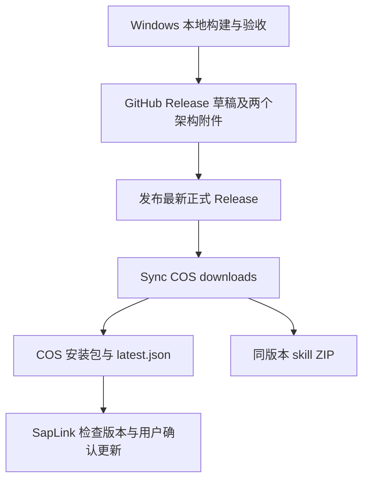

# SapLink 发布与 GitHub Actions

面向项目维护者。用户安装与升级见 [安装指南](windows-installer.md)，本地构建见 [开发与构建指南](development.md)。

## 1. 发布链路与职责



当前 `.github/workflows` 仅保留 COS 下载同步工作流，没有 push/PR 自动测试、Windows 安装包构建或自动创建 Release 的工作流。本地 `release.ps1` 更新版本并打包，不提交 Git、不创建标签、不上传发布。上传 Git 标签本身也不会触发该工作流。

| 工作流 | 文件 | 目标 | Actions secret | 超时 |
| --- | --- | --- | --- | --- |
| Sync COS downloads | [sync-cos-downloads.yml](../.github/workflows/sync-cos-downloads.yml) | 国内更新源和下载文件 | COS_SECRET_ID、COS_SECRET_KEY | 90 分钟 |

工作流运行在 ubuntu-latest，仓库权限为 contents: read，只允许 `OneOFF-ive/saplink` 执行。使用 concurrency group 串行同步，cancel-in-progress=false，避免发布任务相互覆盖。

## 2. 首次配置

1. 将工作流和 `.github/scripts` 脚本提交到主仓库的 main。工作流固定检出 main 上的同步脚本，不使用 Release 标签中的脚本；checkout 不保留 Git 凭据。
2. 在仓库 Settings → Secrets and variables → Actions 添加所需 secrets。值仅在 GitHub 设置中录入，不提交配置或写到发布说明。
3. COS 需要可用的专用凭据和预先配置的公开下载权限。固定桶为 saplink-1302377695、地域 ap-shanghai，前缀 saplink/；具体最小权限见 [COS 发布说明](development.md#github-release-自动同步到-cos)。工作流不修改桶 ACL。

COS 工作流固定安装 cos-python-sdk-v5==1.9.44，并先运行离线同步回归再访问云端。不要为排障将密钥、SDK 请求上下文或原始认证错误写入 Actions 日志。

## 3. 正式发布步骤

1. 在 Windows 构建机使用 `release.ps1 -Version <三段数字版本>` 构建，执行项目及安装包验收。命令、架构限制见 [开发指南](development.md#更新版本并打包)。
2. 准备两个架构的安装包，确保 package.json、锁文件、产品版本和标签版本一致；两个架构必须来自同一待发布版本。
3. 确认安装包和 Skill 对应的技能源码均已提交。Windows 打包将 Markdown/YAML 换行统一为 LF，Action 会逐文件核对标签内容；未提交的技能修改不会被标签包含。创建对应代码提交的 Release 草稿，标签必须是 `vMAJOR.MINOR.PATCH`，例如 v1.0.1。本地构建脚本的 -Version 不带 v，Release 标签必须带 v。
4. 上传 `SapLink-<version>-win-x64-setup.exe` 和 `SapLink-<version>-win-arm64-setup.exe`，同时上传 `SapLink-<version>-skill.zip`、`SapLink-<version>-skill.zip.sha256`、安装包的 `.sha256` 与真实变更说明。
5. 附件上传完成后发布为最新正式 Release，不设为 prerelease。确认 COS Action 启动并检查结果。
6. 验证官网技能入口和 COS 清单，再在客户端运行 `saplink update check --force --json` 检查来源、版本和架构下载信息。检查源码版本等于远端版本时不会提示升级，这是正常行为。

同步脚本需要两个架构的附件，以及 GitHub API 提供的 SHA-256 digest 和 uploaded 状态。每个附件须大于 0 且不超过 256 MiB。脚本最多探测 18 次，间隔 10 秒，单次网络请求另有超时；缺少架构、附件重名或 digest 未就绪会等待后失败，不发布半套下载。

安装包的 `.sha256` 附件不是同步脚本的输入依据：准备脚本重新下载两个官方 exe，核对大小和 GitHub digest。它不会从源码重新构建，也不执行下载的安装程序。

## 4. 触发方式与补同步

工作流支持：

- release.published：正式 Release 发布时触发；job 跳过预发布。
- workflow_dispatch：Actions 页面手动运行，release_tag 留空选择 GitHub latest，或填写完整标签。
- workflow_call：供后续发布工作流显式调用，传递 release_tag 和该工作流声明的 secrets。

准备脚本只处理 GitHub latest 指向的正式版本。手动指定非 latest 的旧标签会输出 ready=false 并跳过，不会把下载入口回退到旧版。同步按钮的绿色结果可能表示跳过，必须核对 prepare 日志和公开版本。

补同步步骤：GitHub → Actions → 选择工作流 → Run workflow，选择 main，release_tag 留空或填写最新正式标签。只运行 COS 同步，不需要另建 Release 或重新上传相同二进制。仅追加附件或编辑现有 Release 不属于 published 事件；修复后手动运行或重跑失败任务。

如果其他工作流使用默认 GITHUB_TOKEN 创建 Release，不能依赖其 published 事件继续触发同步。应在附件就绪后显式调用 reusable workflow，并传入所需 secrets，或手动 dispatch。此行为依据 [GitHub 工作流触发规则](https://docs.github.com/en/actions/how-tos/write-workflows/choose-when-workflows-run/trigger-a-workflow)。当前仓库没有这样的上游发布工作流。

## 5. COS 发布结果与官网下载入口

### COS 更新源

工作流复用 [prepare-cos-release.py](../.github/scripts/prepare-cos-release.py) 核验附件，再由 [sync-cos-release.py](../.github/scripts/sync-cos-release.py) 发布。

- 版本文件位于 saplink/v<version>/，包括两个 exe 与各自 `.sha256`。
- 安装包使用 1 MiB 分块、最多三线程上传，SDK 校验远端已完成块后续传；需补齐[分块上传权限](development.md#github-release-自动同步到-cos)。初始化及最终合并都禁止覆盖同名对象。
- Skill 的来源选择不会跳过 SHA-256 或标签源码校验；附件已下载但校验失败时停止，不能以重新生成掩盖冲突。
- 客户端清单位于 saplink/latest.json，使用 schema_version、version、published_at、downloads。
- 先上传并匿名 HTTPS 下载验证各安装包，最后更新 latest.json；同版本内容冲突或损坏文件报错，不静默覆盖。
- 匿名校验按 1 MiB Range 顺序读取，失败段最多尝试三次，核对长度、ETag 及完整 SHA-256；日志显示上传、回读、清单提交阶段及字节进度。
- 上传前后复核 GitHub latest 和 COS 版本，避免旧事件覆盖新指针；不保护工作流外的人工作业。
- 同步失败时新版本文件可能已上传，不能当作发布事务已回滚；指针提交前保留旧清单。指针提交后的读回失败需要进一步核实公开状态。

公开清单：[COS latest.json](https://saplink-1302377695.cos.ap-shanghai.myqcloud.com/saplink/latest.json)。应用正常时优先使用 COS，不同时查询所有源取最大版本；因此发版必须确认清单已同步。

同一 COS Action 优先使用经过校验的 Release 技能 ZIP 与校验附件，附件缺失或无法下载时从对应标签源码生成，和两个架构安装包统一放在 `saplink/v<version>/`。三个文件全部上传并通过匿名下载 SHA-256 校验后，先更新 `saplink/skill-latest.json`，再更新保持旧格式的安装包清单 `saplink/latest.json`。

- 技能文件：`saplink/v<version>/SapLink-<version>-skill.zip` 及 `.zip.sha256`。
- 安装包清单只包含 schema_version、version、published_at、downloads；独立技能清单 skill-latest.json 包含 schema_version、version、published_at 和 skill（commit、filename、url、size、sha256）。skill.url 为 COS 完整下载地址。

清单使用 no-cache，版本文件长期缓存且禁止覆盖；同版本技能冲突报错。安装包清单不添加 skill 字段；同版本技能补发只更新独立的 skill-latest.json，安装包链接和哈希保持不变。技能上传或校验失败时不发布新清单，重跑可复用并核验已有对象。仍使用原 secrets 和 `saplink/` 对象授权范围。已发布的旧客户端仍读取原格式 latest.json；新版客户端兼容过渡期清单，但发布端不依赖这种宽容行为。

### 官网只提供下载入口

官网不再存储安装包或技能 ZIP，不再使用 SSH 上传接收器。官网代理 COS 的两个小型清单，浏览器从 COS 直接下载文件。旧的 `Sync website skill` 工作流及接收器已从源码删除，不应恢复或重新配置 `SAPLINK_WEBSITE_SYNC_KEY`。

Skill ZIP 由 `skill_archive.py` 优先读取 Release ZIP 与校验附件，附件不可用时才从 Release 标签源码生成；已下载但校验失败时中止，不覆盖或绕过。其内容必须与标签中的技能源码一致，保留顶层 `saplink-manager/`、`SKILL.md`、`agents/`、`references/`。修改技能后需发布包含修改的新标签；不覆盖同版本不可变 ZIP。

## 本地手动补同步 COS

当 GitHub Runner 跨境上传超时，可在本机执行 [scripts/sync-cos.ps1](../scripts/sync-cos.ps1)。此入口复用 Action 发布器，同步双架构安装包、技能 ZIP、校验文件、发布说明和现有两个下载清单，不重新构建应用，不改动官网代码或当前清单格式。

先停止或等待正在运行的 COS Action 完成，再手动同步；本地进程不受 GitHub concurrency group 保护，也不要同时运行多个本地发布进程。GitHub 正式 Release 必须已发布为 latest，两个安装包附件上传完成且具有 GitHub SHA-256。旧版本、预发布和本地文件与官方附件不一致时会停止。

需要 Python 3.10+。在项目根目录的 PowerShell 执行（将示例版本替换为实际最新正式版本）：

```powershell
# 先预演：读取 GitHub，核对本地安装包和官方技能；不访问 COS、不需要 COS 密钥。
.\scripts\sync-cos.ps1 -ReleaseTag v1.0.9 -DryRun

# 实际补同步；默认使用 outputs/installers/1.0.9 中的两个安装包。
.\scripts\sync-cos.ps1 -ReleaseTag v1.0.9

# 本地文件位于其他目录时：
.\scripts\sync-cos.ps1 -ReleaseTag v1.0.9 -Directory 'D:\SapLink releases\1.0.9'
```

不传 `-ReleaseTag` 时读取 GitHub latest，并使用对应的 `outputs/installers/<version>/`。脚本不会把本地 package.json 的版本当作已发布版本。它在本地原位置读取安装包，不重新从 GitHub 下载 exe，不覆盖安装包目录中的 `latest.json`；临时工作目录位于已忽略的 `.saplink/cos-local/`，结束后清理。本地安装包 SHA-256 必须与 GitHub 一致，单独修改本地 `.sha256` 无法绕过校验。

技能 ZIP 沿用 Action 策略：优先从 Release 下载 ZIP 与校验附件并验证标签源码，附件不可用时从发布标签生成，不能用当前工作目录里尚未发布的技能替代。

未设置环境变量时，实际同步会依次提示隐藏输入 COS SecretId、SecretKey，只保留在本次进程内存中。也可预先在当前终端设置 `COS_SECRET_ID`、`COS_SECRET_KEY`；GitHub Actions secrets 不会自动传到本机。权限和目标与 Action 相同，不需要提供账号主密钥。GitHub API 匿名请求受限时，可在当前终端设置只读 `GH_TOKEN`；脚本不会自动读取 git 凭据，也不会将密钥写进脚本、命令参数或日志。

首次实际同步会在 `.saplink/cos-local/venv/` 创建隔离 Python 环境，安装与 Action 相同的 `cos-python-sdk-v5==1.9.44`，之后复用，不污染系统 Python。预演无需 SDK。Python 不在 PATH 时，可追加 `-Python 'C:\path\to\python.exe'`。若 Windows 阻止运行本地脚本，可使用：

```powershell
powershell.exe -NoProfile -ExecutionPolicy Bypass -File .\scripts\sync-cos.ps1 -ReleaseTag v1.0.9
```

网络中断或 Ctrl+C 后，可重新执行同一条命令；复核并复用已上传对象和安装包分块，不覆盖同版本已发布文件。上传成功必须看到 `Local COS synchronization succeeded`，脚本退出码为 0，并再次读取公开下载和清单确认。预演只证明本地文件与 GitHub 来源一致，不验证 COS 权限、上传网络或公开下载权限。本地补同步不会改变之前 Action 的失败状态。

本地也可以直接使用已装好固定版本 SDK 的 Python：

```powershell
python scripts/sync-cos-local.py --tag v1.0.9 --directory outputs/installers/1.0.9
python scripts/test-sync-cos-local.py -v
```

## 6. 常见问题

| 现象 | 检查与处理 |
| --- | --- |
| 发布后没有 Actions | 核对 main 是否已有工作流、是否为 published 正式 Release、是否由 GITHUB_TOKEN 发布；必要时手动运行 |
| fork 中 job 被跳过 | 固定仓库条件阻止运行；需要部署到其他仓库时应先调整并审查仓库身份及固定目标 |
| 一直等待两个附件 | 核对标准文件名、双架构、uploaded 状态、大小和 GitHub digest；就绪后重跑 |
| 任务成功但版本没变 | 核对 ready=false、latest 标签及 COS 已有更高版本，不把 skip 当作新版本上传成功 |
| COS 失败 | 按阶段和字节日志检查 secrets、分块上传及列举权限、公开读、网络和同版本内容冲突；中断后新运行可复用已完成上传块，不改哈希或覆盖二进制绕过 |

## 7. 本地验证与边界

在项目根目录执行：

```powershell
python .github/scripts/test-sync-cos-release.py -v
python .github/scripts/test-skill-archive.py -v
python .github/scripts/test-prepare-cos-release.py -v
```

这些回归使用模拟安装包、内存 COS 和隔离暂存目录，不读取密钥、不操作云端；需要可用的 Python。COS 工作流中额外验证已安装 SDK 的兼容性。离线测试通过不等于 Actions secrets 已配置、云端发布成功。

本手册只描述仓库配置，不代表已运行线上 Actions。本地构建、安装测试和云端同步应分别记录验证结果。

## 修复旧客户端更新清单兼容性

推送代码到 main 后，在 **Sync COS downloads → Run workflow** 中将 `repair_metadata` 设为 true；无需指定 release_tag。该选项仅修复元数据：核实当前公开清单及 Skill ZIP、写入 `saplink/manifest-backups/` 备份、发布独立 `saplink/skill-latest.json`，再从 latest.json 移除 skill。安装包 URL、SHA-256、版本、发布时间和二进制不变。原清单异常或校验失败时停止，不覆盖安装包。重复运行已修复清单不写入。此模式使用原有 Actions Secrets，不需要将密钥交给本机。

正常发布同样维持双清单。不要手工覆盖不可变的同版本 Skill ZIP，也不要将技能元数据重新合并进 latest.json。
