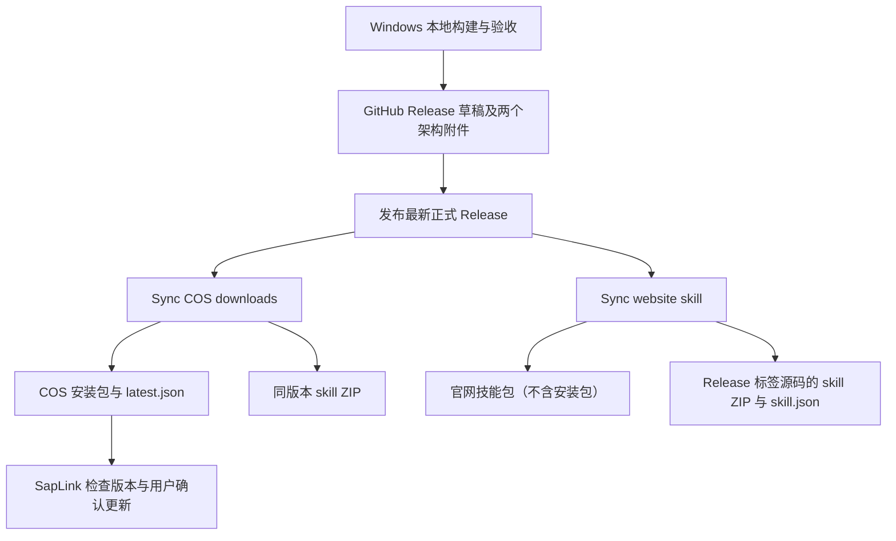

# SapLink 发布与 GitHub Actions

面向项目维护者。核对日期：2026-10-18，仓库源码版本为 1.0.1；这不表示该版本已公开发布。用户安装与升级见 [安装指南](windows-installer.md)，本地构建见 [开发与构建指南](development.md)。

## 1. 发布链路与职责



当前 `.github/workflows` 只有两条下载同步工作流，没有 push/PR 自动测试、Windows 安装包构建或自动创建 Release 的工作流。本地 `release.ps1` 更新版本并打包，不提交 Git、不创建标签、不上传发布。上传 Git 标签本身也不会触发这两条工作流。

| 工作流 | 文件 | 目标 | Actions secret | 超时 |
| --- | --- | --- | --- | --- |
| Sync COS downloads | [sync-cos-downloads.yml](../.github/workflows/sync-cos-downloads.yml) | 国内更新源和下载文件 | COS_SECRET_ID、COS_SECRET_KEY | 90 分钟 |
| Sync website skill | [sync-website-downloads.yml](../.github/workflows/sync-website-downloads.yml) | 官网下载接收端 | SAPLINK_WEBSITE_SYNC_KEY | 90 分钟 |

两条工作流均运行在 ubuntu-latest，仓库权限为 contents: read，只允许 `OneOFF-ive/saplink` 执行。各自使用独立 concurrency group 串行同步，cancel-in-progress=false，不互相等待；一条成功不代表另一条成功。

## 2. 首次配置

1. 将工作流和 `.github/scripts` 脚本提交到主仓库的 main。两条工作流固定检出 main 上的同步脚本，不使用 Release 标签中的脚本；checkout 不保留 Git 凭据。
2. 在仓库 Settings → Secrets and variables → Actions 添加所需 secrets。值仅在 GitHub 设置中录入，不提交配置或写到发布说明。
3. COS 需要可用的专用凭据和预先配置的公开下载权限。固定桶为 saplink-1302377695、地域 ap-shanghai，前缀 saplink/；具体最小权限见 [COS 发布说明](development.md#github-release-自动同步到-cos)。工作流不修改桶 ACL。
4. 官网技能同步需要已部署受限 SSH 接收端。当前目标、专用账号及固定 SSH 主机公钥位于工作流内，密钥 secret 为 SAPLINK_WEBSITE_SYNC_KEY。服务器接收器的部署不在本仓库工作流内自动完成；更换主机需同时核对地址、公钥和接收协议。

COS 工作流固定安装 cos-python-sdk-v5==1.9.44，并先运行离线同步回归再访问云端。不要为排障将密钥、SDK 请求上下文或原始认证错误写入 Actions 日志。

## 3. 正式发布步骤

1. 在 Windows 构建机使用 `release.ps1 -Version <三段数字版本>` 构建，执行项目及安装包验收。命令、架构限制见 [开发指南](development.md#更新版本并打包)。
2. 准备两个架构的安装包，确保 package.json、锁文件、产品版本和标签版本一致；两个架构必须来自同一待发布版本。
3. 创建对应代码提交的 Release 草稿，标签必须是 `vMAJOR.MINOR.PATCH`，例如 v1.0.1。本地构建脚本的 -Version 不带 v，Release 标签必须带 v。
4. 上传 `SapLink-<version>-win-x64-setup.exe` 和 `SapLink-<version>-win-arm64-setup.exe`，建议同时附上本地产生的 `.sha256` 与真实变更说明。
5. 附件上传完成后发布为最新正式 Release，不设为 prerelease。确认两条 Actions 启动并分别检查结果。
6. 验证官网技能入口和 COS 清单，再在客户端运行 `saplink update check --force --json` 检查来源、版本和架构下载信息。检查源码版本等于远端版本时不会提示升级，这是正常行为。

同步脚本需要两个架构的附件，以及 GitHub API 提供的 SHA-256 digest 和 uploaded 状态。每个附件须大于 0 且不超过 256 MiB。脚本最多探测 18 次，间隔 10 秒，单次网络请求另有超时；缺少架构、附件重名或 digest 未就绪会等待后失败，不发布半套下载。

`.sha256` 附件不是同步脚本的输入依据：准备脚本重新下载两个官方 exe，核对大小和 GitHub digest。它不会从源码重新构建，也不执行下载的安装程序。

## 4. 触发方式与补同步

两条工作流均支持：

- release.published：正式 Release 发布时触发；job 跳过预发布。
- workflow_dispatch：Actions 页面手动运行，release_tag 留空选择 GitHub latest，或填写完整标签。
- workflow_call：供后续发布工作流显式调用，传递 release_tag 和该工作流声明的 secrets。

准备脚本只处理 GitHub latest 指向的正式版本。手动指定非 latest 的旧标签会输出 ready=false 并跳过，不会把下载入口回退到旧版。同步按钮的绿色结果可能表示跳过，必须核对 prepare 日志和公开版本。

补同步步骤：GitHub → Actions → 选择工作流 → Run workflow，选择 main，release_tag 留空或填写最新正式标签。COS 与官网分别运行，不需要另建 Release 或重新上传相同二进制。仅追加附件或编辑现有 Release 不属于 published 事件；修复后手动运行或重跑失败任务。

如果其他工作流使用默认 GITHUB_TOKEN 创建 Release，不能依赖其 published 事件继续触发同步。应在附件就绪后显式调用 reusable workflow，并分别传入所需 secrets，或手动 dispatch。此行为依据 [GitHub 工作流触发规则](https://docs.github.com/en/actions/how-tos/write-workflows/choose-when-workflows-run/trigger-a-workflow)。当前仓库没有这样的上游发布工作流。

## 5. 两个同步目标的结果

### COS 更新源

工作流复用 [prepare-website-release.py](../.github/scripts/prepare-website-release.py) 核验附件，再由 [sync-cos-release.py](../.github/scripts/sync-cos-release.py) 发布。

- 版本文件位于 saplink/v<version>/，包括两个 exe 与各自 `.sha256`。
- 安装包使用 1 MiB 分块、最多三线程上传，SDK 校验远端已完成块后续传；需补齐[分块上传权限](development.md#github-release-自动同步到-cos)。初始化及最终合并都禁止覆盖同名对象。
- 客户端清单位于 saplink/latest.json，使用 schema_version、version、published_at、downloads。
- 先上传并匿名 HTTPS 下载验证各安装包，最后更新 latest.json；同版本内容冲突或损坏文件报错，不静默覆盖。
- 匿名校验按 1 MiB Range 顺序读取，失败段最多尝试三次，核对长度、ETag 及完整 SHA-256；日志显示上传、回读、清单提交阶段及字节进度。
- 上传前后复核 GitHub latest 和 COS 版本，避免旧事件覆盖新指针；不保护工作流外的人工作业。
- 同步失败时新版本文件可能已上传，不能当作发布事务已回滚；指针提交前保留旧清单。指针提交后的读回失败需要进一步核实公开状态。

公开清单：[COS latest.json](https://saplink-1302377695.cos.ap-shanghai.myqcloud.com/saplink/latest.json)。应用正常时优先使用 COS，不同时查询所有源取最大版本；因此发版必须确认清单已同步。

同一 COS Action 从 Release 标签源码生成与官网一致的技能 ZIP，和两个架构安装包统一放在 `saplink/v<version>/`。三个文件全部上传并通过匿名下载 SHA-256 校验后，先更新 `saplink/skill-latest.json`，再更新保持旧格式的安装包清单 `saplink/latest.json`。

- 技能文件：`saplink/v<version>/SapLink-<version>-skill.zip` 及 `.zip.sha256`。
- 清单保留 schema_version、version、published_at、downloads，并新增 skill 对象（commit、filename、url、size、sha256），共同使用顶层 version，不提供独立技能版本清单。skill.url 是 COS 完整下载地址。

清单使用 no-cache，版本文件长期缓存且禁止覆盖；同版本技能冲突报错。安装包清单不添加 skill 字段；同版本技能补发只更新独立的 skill-latest.json，安装包链接和哈希保持不变。技能上传或校验失败时不发布新清单，重跑可复用并核验已有对象。仍使用原 secrets 和 `saplink/` 对象授权范围。已发布的旧客户端仍读取原格式 latest.json；新版客户端兼容过渡期清单，但发布端不依赖这种宽容行为。

### 官网仅发布 Skill

官网不再保存或同步安装包。安装和更新优先使用 COS 的 `saplink/latest.json`，GitHub 正式 Release 作为备用来源；官网的下载页面只读取清单并跳转到 COS 文件。不要把官网代理的清单地址配置为程序更新源。

[官网技能工作流](../.github/workflows/sync-website-downloads.yml)保留原文件名以兼容调用，显示名称为 `Sync website skill`。它设置 `SKILL_ONLY=1`，只确认最新正式 Release、从对应标签源码生成技能 ZIP、通过受限 SSH 接收器发布并回读校验；不下载或上传 EXE，不再依赖网站安装包清单及二进制验证。COS Action 继续独立发布双架构安装包及同标签技能包。

官网技能接收器仍需已有 `skill <version>` 命令。相关文件为 `website_skill.py`、`website_upload_receiver.py`、`install-website-upload.py`，已有接收器无需因停止安装包同步而重新部署。旧的安装包上传脚本保留用于历史排查，不被官网发布工作流调用。

- 最新技能包：`/downloads/skills/latest/saplink-manager.zip`
- 技能元数据：`/downloads/skills/latest/skill.json`

技能 ZIP 保留顶层 `saplink-manager/`、`SKILL.md`、`agents/`、`references/`，服务器按对应 Release 标签源码重建并核验。同版本冲突报错，失败可重跑；修改技能源码后需推送并发布包含修改的标签，重跑旧标签不会包含新技能。网站当前源码快照技能包与标签发布包应明确区分。

## 6. 常见问题

| 现象 | 检查与处理 |
| --- | --- |
| 发布后没有 Actions | 核对 main 是否已有工作流、是否为 published 正式 Release、是否由 GITHUB_TOKEN 发布；必要时手动运行 |
| fork 中 job 被跳过 | 固定仓库条件阻止运行；需要部署到其他仓库时应先调整并审查仓库身份及固定目标 |
| 一直等待两个附件 | 核对标准文件名、双架构、uploaded 状态、大小和 GitHub digest；就绪后重跑 |
| 任务成功但版本没变 | 核对 ready=false、latest 标签及 COS 已有更高版本，不把 skip 当作新版本上传成功 |
| COS 失败 | 按阶段和字节日志检查 secrets、分块上传及列举权限、公开读、网络和同版本内容冲突；中断后新运行可复用已完成上传块，不改哈希或覆盖二进制绕过 |
| 官网 SSH 失败 | 检查 secret、专用账号、受限接收器和固定主机公钥；不关闭 StrictHostKeyChecking |
| 官网传输中断或超时 | 核对日志中的具体块，确认服务端已部署续传扩展；重跑会保留并复核已完成块，不必重新上传整包；链路持续不可用时仍会失败 |
| 官网文件在但版本验证失败 | 检查公开 releases.json 和接收器的 latest 切换；仅文件存在不足以确认同步完成 |
| COS 成功、官网失败 | 两条流程独立；只修复并重跑失败目标，再分别核实 |

## 7. 本地验证与边界

在项目根目录执行：

```powershell
python .github/scripts/test-sync-cos-release.py -v
python .github/scripts/test-website-upload.py -v
python .github/scripts/test-website-skill.py -v
```

这些回归使用模拟安装包、内存 COS 和隔离暂存目录，不读取密钥、不操作云端；需要可用的 Python。COS 工作流中额外验证已安装 SDK 的兼容性。在 Linux 上可设置 `RECEIVER_MODULE` 为原接收器脚本绝对路径，额外验证拼接后的载荷能由原接收器校验并发布到测试目录。离线测试通过不等于 Actions secrets 已配置、官网接收器已部署或云端发布成功。

本手册只描述仓库配置，不代表已运行线上 Actions。本地构建、安装测试和云端同步应分别记录验证结果。

## 修复旧客户端更新清单兼容性

推送代码到 main 后，在 **Sync COS downloads → Run workflow** 中将 `repair_metadata` 设为 true；无需指定 release_tag。该选项仅修复元数据：核实当前公开清单及 Skill ZIP、写入 `saplink/manifest-backups/` 备份、发布独立 `saplink/skill-latest.json`，再从 latest.json 移除 skill。安装包 URL、SHA-256、版本、发布时间和二进制不变。原清单异常或校验失败时停止，不覆盖安装包。重复运行已修复清单不写入。此模式使用原有 Actions Secrets，不需要将密钥交给本机。

正常发布同样维持双清单。不要手工覆盖不可变的同版本 Skill ZIP，也不要将技能元数据重新合并进 latest.json。
